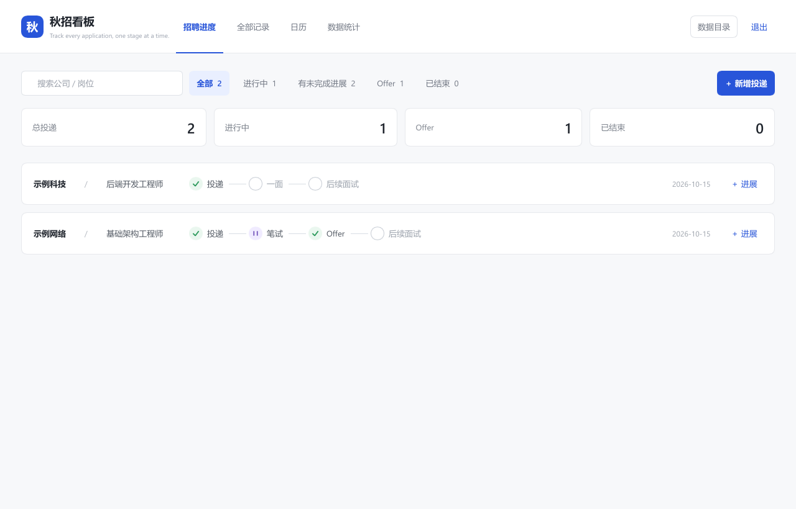
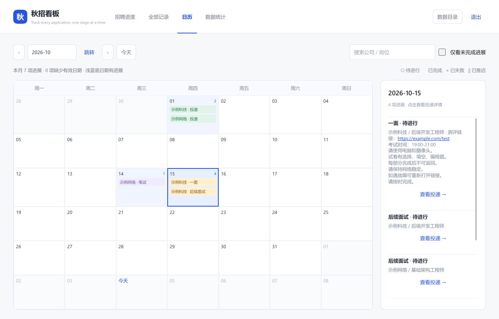
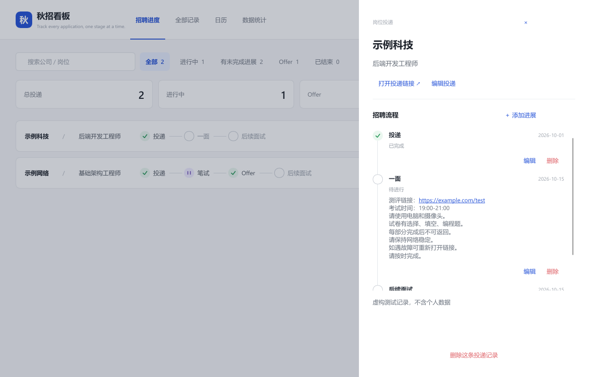
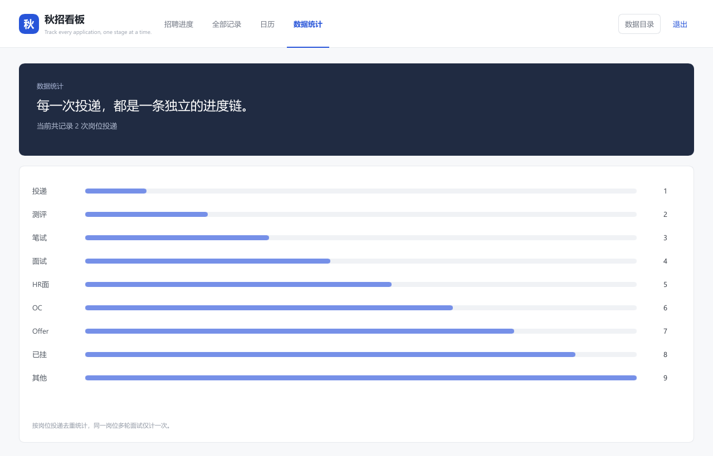

# 秋招看板桌面版

## 界面预览

以下截图使用程序内置的虚构示例数据，展示当前原生版界面。点击图片可查看大图。

### 招聘进度

[](docs/images/dashboard.png)

### 日历

[](docs/images/calendar.png)

### 投递详情

[](docs/images/application-detail.png)

### 数据统计

[](docs/images/statistics.png)

## 当前版本：v2.0.8 原生便携版

当前主版本采用 Rust + Slint。可从 [v2.0.8 发布页](https://github.com/pmssl/autumn-recruitment-dashboard/releases/tag/v2.0.8)直接下载 Windows x64 的 `autumn-native.exe`，放在可写目录后双击运行，无需安装；ZIP 是含同一 EXE 和说明文件的可选压缩包。无需安装 Node.js 或浏览器运行时。

v2.0.6 新增运行时本机 API，可在程序运行时查询、新增和修改投递及进展；详情中的备注网址可直接点击，长备注可滚动查看，流程连接线保持连续。

v2.0.7 让日历详情和招聘流程的进展行随备注长度调整高度，并在岗位详情的进展列表右侧预留滚动条空间，避免遮挡日期与删除按钮。上方投递详情截图展示了修复后的布局。

v2.0.8 在招聘进度中让整张投递卡片避开滚动条，全部记录的表头和内容也为滚动条留出空间。

v2.0.5 新增“已推迟”进展状态，用于保留改期的历史场次；新场次可单独标记为“待进行”。包含该状态的数据需使用 v2.0.5 或更新版本打开。

v2.0.4 修复数据统计列表出现滚动条时遮挡右侧计数的问题。

v2.0.3 修复招聘进度搜索无匹配结果时，搜索框和筛选按钮突然变高的问题。

v2.0.2 更新 Slint，修复 Windows 上窗口首次打开及从托盘恢复后可能出现的空白或透明区域。当前固定到包含修复的上游开发提交，详见 [窗口重绘试验](docs/SLINT_REPAINT_TRIAL.md)。

支持投递和进展管理、搜索、状态与未完成筛选、全部记录、日历、统计、托盘。首次运行会在 EXE 旁创建 `data/`，首次保存后生成 `data/applications.json`；移动程序时一起移动 `data/`。升级前退出托盘中的程序，备份 `data/`，再替换 EXE。发布附件不包含个人数据。

旧版数据不会自动导入：退出旧版并备份其数据后，可运行 `autumn-native.exe --import-legacy "旧版 applications.json 的完整路径"`，仅允许导入到尚无数据的新目录。也可用 `--data-dir` 指定数据目录。具体开发与数据说明见 [native/README.md](native/README.md)。

## 本机 API 与项目 Skill

仓库提供 [autumn-dashboard-api Skill](.agents/skills/autumn-dashboard-api/SKILL.md)，用于让 Codex 通过**正在运行的原生程序**查询、新增和修改投递及招聘进展。它会先核对目标投递，写入后再回读确认；适合补充笔试、面试通知或更正已有进展。Skill 是仓库中的操作说明，不包含在单独下载的 EXE 内。

程序运行时会在 EXE 旁的 `data/` 中建立仅供本机连接的 API 地址文件。仓库内的 `autumn-native.exe --api` 从标准输入接收一条 JSON 请求，连接正在运行、使用同一数据目录的程序；修改由运行中的程序保存并刷新界面。程序未运行时不能调用该接口。若使用 `--data-dir`，API 调用也须指定相同目录。操作字段和 PowerShell 示例见 [本机 API 参考](.agents/skills/autumn-dashboard-api/references/api.md)；数据目录与备份行为见 [原生版说明](native/README.md#运行时本机-api)。

本次仅提供 Windows x64 产物；macOS/Linux 尚未完成实机验证。当前不提供 Excel 导入、开机启动和重复启动恢复窗口；数据目录被其他实例占用时会提示退出已有实例。

旧版 v1.0.3 Release 和下方 Electron 源码使用说明继续保留。

## 旧版 v1.0.3（Electron）

Windows 桌面程序，保留招聘进度、全部记录、统计、Excel 导入等功能。

## 安装和使用

运行 `release/Autumn-Dashboard-Setup-1.0.3.exe` 完成安装，从桌面快捷方式启动。

- 点击窗口关闭按钮：隐藏到系统托盘，程序继续运行。
- 点击托盘图标：恢复窗口。图标可能位于任务栏的折叠区域。
- 右键托盘图标 → 退出：完全退出程序。
- 右键托盘图标 → 开机启动：自行开启或关闭，默认不开启；开启后登录 Windows 时静默驻留托盘。
- 重复启动只会恢复已有窗口。
- 使用程序不需要 Node.js、浏览器或开发服务器。

## 数据

桌面版数据保存到 `%APPDATA%/秋招看板/applications.json`，托盘菜单可打开实际数据文件夹。
每次保存保留上一版本 `applications.json.bak`，它不是完整历史备份。可自行复制整个数据文件夹备份。
如需恢复，先退出程序，再用备份替换 applications.json。
读取损坏的数据会阻止编辑，避免覆盖原文件；保存失败会在窗口内提示并提供重试按钮。
在没有既有桌面版数据的情况下，首次运行为空白记录；浏览器 localStorage 数据不会自动迁移。
Excel 导入只处理第一个工作表的公司、岗位、日期，每行生成一条投递；日期建议使用 YYYY-MM-DD 文本，重复导入不会去重。

## 开发与打包

```powershell
npm install
npm run desktop
```

生成 Windows x64 安装包：

```powershell
npm run dist
```

输出在 release，`release/win-unpacked/秋招看板.exe` 可直接运行，但必须保留同目录全部文件。

```powershell
npm test         # 本地存储验证
npm run build    # TypeScript 检查与前端构建
```

采用 Electron 承载本地 React 界面，主进程管理托盘和文件存储。渲染进程不启用 Node.js，通过隔离的 preload API 保存数据。安装包暂未配置代码签名。

## 未完成进展筛选

招聘进度和全部记录页提供“有未完成进展”筛选，显示至少有一个 pending（待进行）节点的投递，可与公司/岗位搜索同时使用。计数按投递条数计算。即使投递整体为 Offer 或已结束，只要仍有待进行节点也会显示，方便清理遗漏进展。

## 日历

点击顶部“日历”，有进展的日期会高亮，按状态区分颜色。可切换月份、返回今天、搜索公司/岗位及仅看未完成进展。选中日期后查看当天所有节点，点击节点打开投递详情进行修改。日期与状态直接读取现有流程数据，编辑后自动更新。未填写有效日期的节点不会被放入日历；截止日期与具体时间以备注原文为准。
